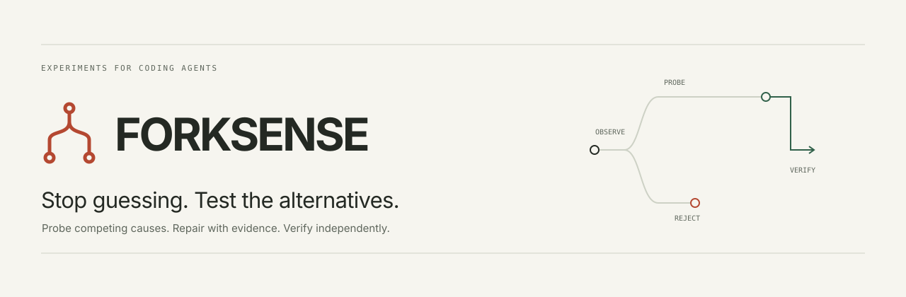
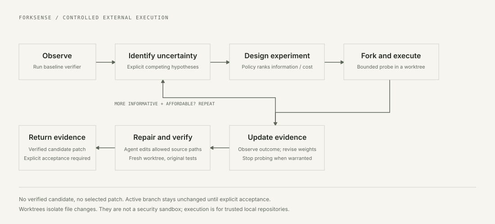
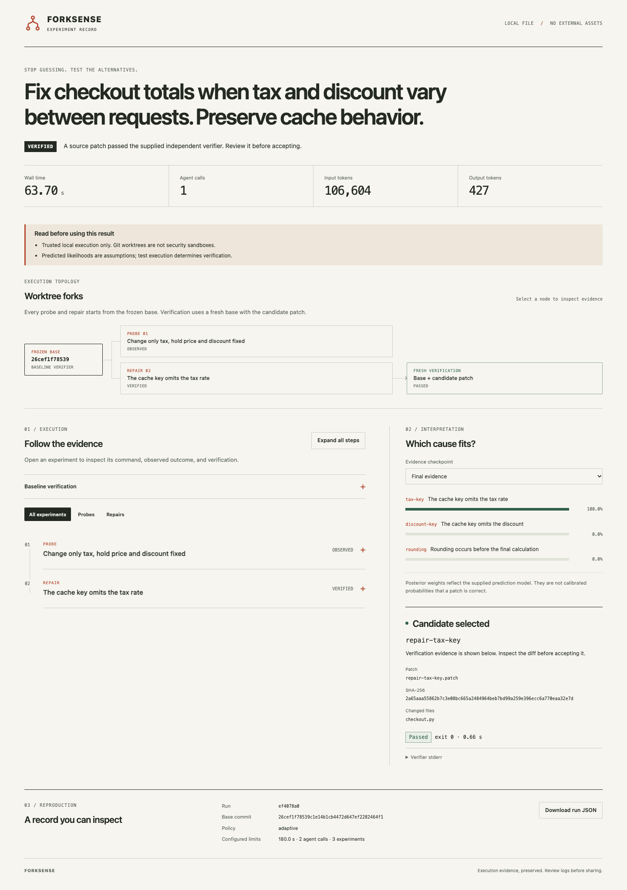
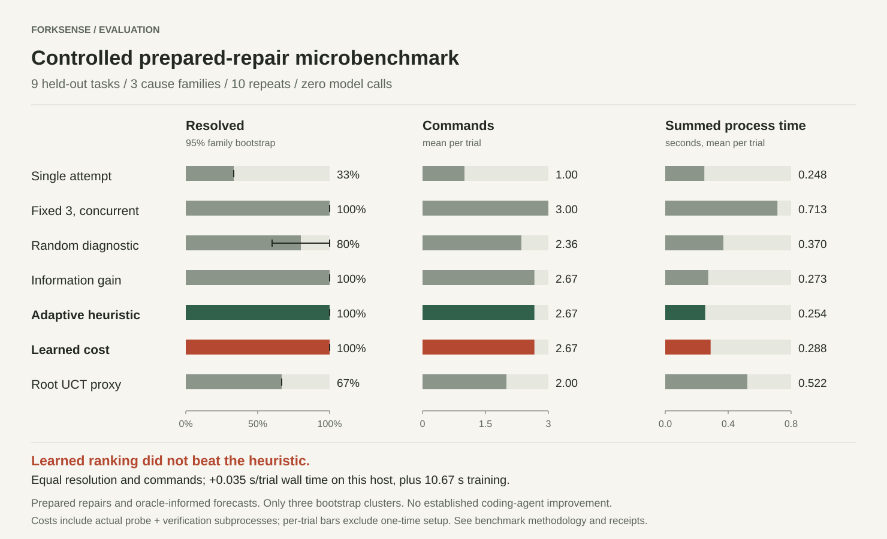

<p align="center"></p>

<p align="center">
  <a href="https://github.com/nazeeh111/ForkSense/actions/workflows/ci.yml"></a>
  <a href="LICENSE"></a>
  
  
</p>

**ForkSense helps an existing coding agent test competing explanations before spending another full repair attempt.** It runs small diagnostic experiments, records what happened, asks the installed agent to repair the best-supported cause, and checks the resulting source patch in a fresh Git worktree.

It is a small, dependency-free Python CLI for trusted local repositories. Codex remains the coding agent. An optional Claude Code adapter uses its documented CLI. ForkSense adds explicit experiments, a separate verifier and an inspectable decision trail.

**Research preview:** the engine works end to end, including a recorded live Codex repair. Broad coding-agent improvement is unproven. The learned cost model did not outperform the simpler heuristic in the controlled evaluation.

## Try it in one command

With [uv](https://docs.astral.sh/uv/) and Git installed:

```sh
uvx --from git+https://github.com/nazeeh111/ForkSense@v0.1.0 forksense demo --output /tmp/forksense-demo
```

Use a fresh output directory. The default demo needs no account, model, API key or runtime Python dependency. It uses clearly labeled prepared patches to demonstrate a checkout cache bug, a discriminating probe, independent tests and explicit patch acceptance.

Open `/tmp/forksense-demo/run/report.html` in a browser. Then inspect the proposed fix:

```sh
uvx --from git+https://github.com/nazeeh111/ForkSense@v0.1.0 forksense accept /tmp/forksense-demo/run/report.json --repo /tmp/forksense-demo/checkout
```

Add `--yes` to apply it. Acceptance does not commit. The demo creates and commits its own disposable fixture; ordinary runs never commit your code.

Prefer a local installation:

```sh
git clone https://github.com/nazeeh111/ForkSense.git
cd ForkSense
python3 -m venv .venv
. .venv/bin/activate
python -m pip install .
forksense demo --output /tmp/forksense-demo-local
```

Python 3.11+ and Git are required. ForkSense is not published to PyPI; install from this repository or the versioned release wheel.

## From uncertainty to evidence

Suppose a checkout returns the wrong total. The bug could involve the tax component of a cache key, the discount component, or rounding. A full implementation for each guess is expensive. A probe that changes only the tax rate can rule out two explanations before the agent edits source.



1. **Observe:** run the original verifier at the frozen base commit.
2. **Distinguish:** select a probe by expected information gain divided by estimated cost. A probe tests the original code in its own worktree.
3. **Repair:** pass the observed evidence and one hypothesis to the installed agent CLI.
4. **Verify:** apply only permitted source changes to another fresh base worktree and run the original test contract.
5. **Review:** inspect the command, output, diff and verifier result; accept separately.

A hypothesis weight is conditional on the plan's predictions. It is not calibrated confidence that a fix is correct. Failed, interrupted and inconclusive attempts remain evidence, not successes.

## Use it on your repository

Start from a clean, committed repository and a trustworthy failing test. The verifier below is an example; use the command that reproduces your own failure.

```sh
forksense doctor --repo /path/to/repo

forksense plan "Fix the cache returning an old total when tax changes" \
  --repo /path/to/repo \
  --verify "python -m unittest discover -s tests" \
  --editable src \
  --agent codex \
  --output /tmp/forksense-plan.json \
  --trust-repo

forksense inspect /tmp/forksense-plan.json

forksense run /tmp/forksense-plan.json \
  --repo /path/to/repo \
  --agent codex \
  --seconds 180 --agent-calls 2 --max-experiments 3 \
  --output /tmp/forksense-run \
  --trust-repo
```

`plan` launches a read-only agent session and costs an additional model call. Inspect its commands, likelihood predictions and source scope before `run`. Keep the plan and run output outside the target repository. Tests must be independent of the repair; agent-generated tests cannot be the sole judge.

`--trust-repo` acknowledges ordinary host execution. Worktrees isolate source edits, not arbitrary operating-system effects. The tool does not make untrusted repository code safe. [Usage and budgets](docs/usage.md) explain the exact boundary.

To use an already installed, authenticated Codex CLI on the controlled fixture:

```sh
forksense demo --agent codex --output /tmp/forksense-live-demo --seconds 180
```

ForkSense reuses the CLI's own login and does not read credential stores or provision keys. [Optional integration skills](integrations) fit the same inspect, run and accept workflow. The Claude adapter is implemented against documented `claude -p` options but has not been run locally because Claude Code was unavailable.

## Inspect the run



The report is one offline HTML file. Expand an experiment to inspect its command and captured output. Move through evidence checkpoints to see the supplied hypothesis weights change. Review patch identity and verification separately. The browser report never applies a patch.

[Watch the short demo](docs/assets/demo.mp4) · [Animated preview](docs/assets/demo-preview.gif) · [Recorded Codex report JSON](docs/evidence/live-codex-demo/report.json) · [Report source and design](docs/design.md)

The captured Codex fixture run used one diagnostic and one repair call, passed four independent contract tests, took 63.70 seconds and left the source checkout unchanged. It demonstrates execution, not a comparative performance gain. The public export omits raw agent transcripts and replaces machine-local paths; it is inspectable evidence, not a directly replayable run directory.

## What the evaluation says



The frozen controlled study contains **18 synthetic tasks**, with **9 held-out tasks from 3 held-out cause families**, repeated across 10 seeds. All selected probes and independent verifiers actually execute. Hypotheses and forecasts are oracle-informed, and repairs are prepared source transformations. There are zero live model calls in this benchmark.

| Policy | Held-out resolution | Commands per trial | Prepared repairs per trial |
| --- | ---: | ---: | ---: |
| Single fixed attempt | 33.3% | 1.00 | 1.00 |
| Fixed 3, concurrent | 100% | 3.00 | 3.00 |
| Random diagnostic selection | 80.0% | 2.36 | 1.00 |
| Information gain | 100% | 2.67 | 1.00 |
| Adaptive heuristic | 100% | 2.67 | 1.00 |
| Learned cost ranking | 100% | 2.67 | 1.00 |
| Root UCT proxy | 66.7% | 2.00 | 2.00 |

Adaptive selection matched the strongest prepared-repair baseline with fewer commands in this setup. It did not improve resolution over fixed-three. The learned model matched the heuristic's resolution and command use, took more wall time on this host, and added 10.67 seconds of training executions. **The simpler heuristic remains the default.**

These are controlled policy results, not a SWE-bench score or proof that ForkSense improves ordinary Codex or Claude Code. The root UCT proxy does not replicate a full tree-search agent. Three family clusters make the reported uncertainty intervals exploratory. Full agent comparisons remain open work.

[Method and prior work](docs/method.md) · [Frozen methodology](benchmarks/README.md) · [Complete results](benchmarks/results-v2/REPORT.md) · [Raw trial receipts](benchmarks/results-v2/trials.jsonl) · [Known limits](docs/limitations.md)

## Small by design

- No runtime Python dependencies, server, dashboard service or hidden model-state access.
- Explicit time, repair-call and diagnostic budgets; token limits are soft checks after a CLI turn reports usage.
- Clean-checkout checks, source-path restrictions, fresh verification and hash-checked acceptance.
- Inspectable JSON plans and offline reports, including failed attempts and partial diffs.
- No automatic commits, pushes, permission bypass flags or telemetry.

The current method uses standard Bayesian updates and information gain. Its research question is whether a small experiment-selection layer earns its extra cost on real coding tasks. The preview provides the engine and reproducible evidence needed to test that question; it does not claim algorithmic novelty or state-of-the-art performance.

## Contribute a useful failure

A small reproducible task with independent tests is more useful than a feature request for another orchestration layer. [Contributing](CONTRIBUTING.md) explains local checks, evidence requirements and how to propose a fair benchmark. [Adoption notes](docs/adoption.md) describe a practical, evidence-first path to broader use.

[MIT license](LICENSE) · [Third-party notices](THIRD_PARTY_NOTICES.md) · [Changelog](CHANGELOG.md)
